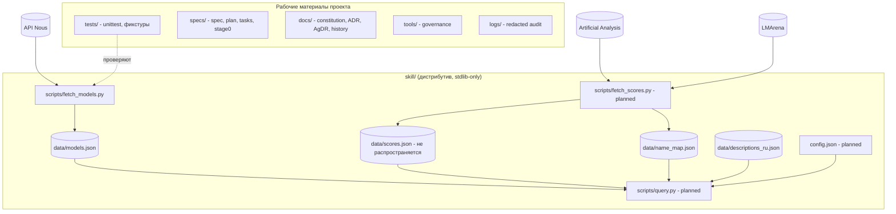

# Containers

Граница дистрибутива скилла — папка `skill/` (ADR-0001, часть C). Остальное — рабочие материалы проекта.

Контракт между скриптами — JSON-файлы в `skill/data/` с полем `schema_version` (сейчас 1 для `models.json`). `fetch_models.py` пишет снапшот атомарно: при ошибке прежний файл остаётся нетронутым.
