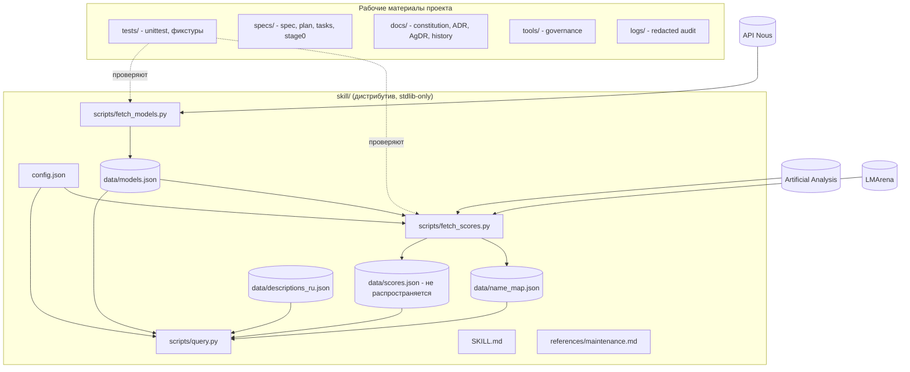

# Containers

Граница дистрибутива скилла — папка `skill/` (ADR-0001, часть C). Остальное — рабочие материалы проекта.

Контракт между скриптами — JSON-файлы в `skill/data/` с полем `schema_version` (сейчас 1 для `models.json`). `fetch_models.py` пишет снапшот атомарно: при ошибке прежний файл остаётся нетронутым.

`fetch_scores.py` читает `models.json` (семейства для сопоставления) и `config.json` (порядок конфигураций, адреса и категории источников, паузы), пишет `scores.json` (`schema_version` 1, `mode`: `full | aa_only | fallback`, статус каждого источника, значения `{value, source, metric, date, config, matched_name}` или `null`) и `name_map.json` (точные совпадения, кандидаты, неоднозначные ключи). Обе записи атомарные; при отказе обоих источников прежние файлы остаются. Правила — AgDR-0002.

`query.py` читает `models.json`, `scores.json` и раздел `query` в `config.json` (категории, соотношения in:out, пороги, spotlight, тексты причин недоступности AA), сети не использует. Расчёты — чистые функции (`recommend`, `flagships`, `spotlight`), вывод — отдельные `render_*`; одинаковые входы дают побайтно одинаковый текст (AgDR-0003). Команды: `recommend --task`, `models --set flagships|spotlight` (шаг 4); `show`, `compare`, `search` (шаг 5; правила — AgDR-0004). Необязательные файлы `descriptions_ru.json` (переводы описаний с хешем оригинала; создаёт агент по процедуре из `references/maintenance.md`, правила выбора множества — AgDR-0005) и `name_map.json` `query.py` читает только для описаний и проверки целостности: id, которых нет в каталоге, помечаются устаревшими в начале вывода, файлы не меняются; битый файл даёт предупреждение. Плюсы и минусы — правила из раздела `pros_cons` в `config.json`.
