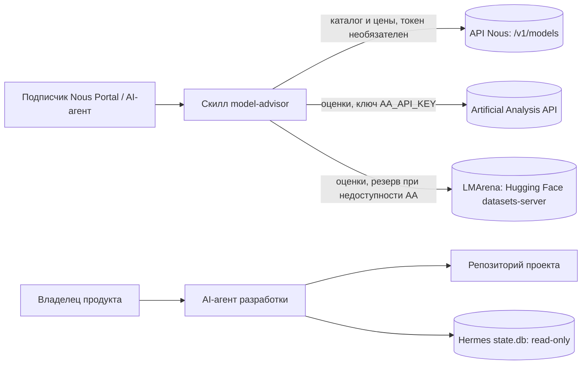

# System Context

Советник по моделям Nous: портативный скилл, который читает каталог Nous Portal и внешние бенчмарки и отвечает на вопросы о выборе модели.

Статус реализации: подключены API Nous (`fetch_models.py`), AA и LMArena (`fetch_scores.py`); `query.py`: `recommend`, `models` (шаг 4), `show`, `compare`, `search` с плюсами и минусами, переводами описаний и проверкой целостности (шаг 5) готовы. `SKILL.md` и `references/maintenance.md` (процедура обновления и перевода описаний агентом) и начальный `descriptions_ru.json` (67 переводов, AgDR-0005) готовы (шаг 6).
