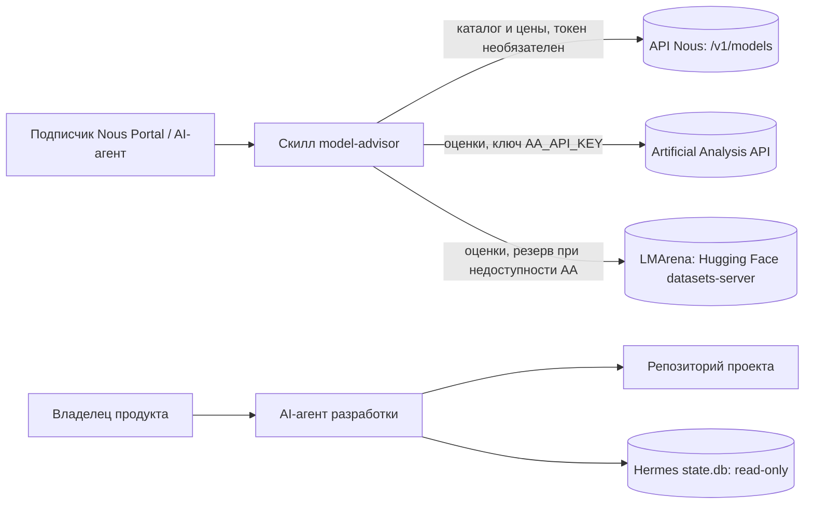

# System Context

Советник по моделям Nous: портативный скилл, который читает каталог Nous Portal и внешние бенчмарки и отвечает на вопросы о выборе модели.

Статус реализации: подключены API Nous (`fetch_models.py`), AA и LMArena (`fetch_scores.py`); `query.py`: `recommend` и `models` готовы (шаг 4), `show`, `compare`, `search` — шаг 5 в `specs/001-model-advisor/tasks.md`.
